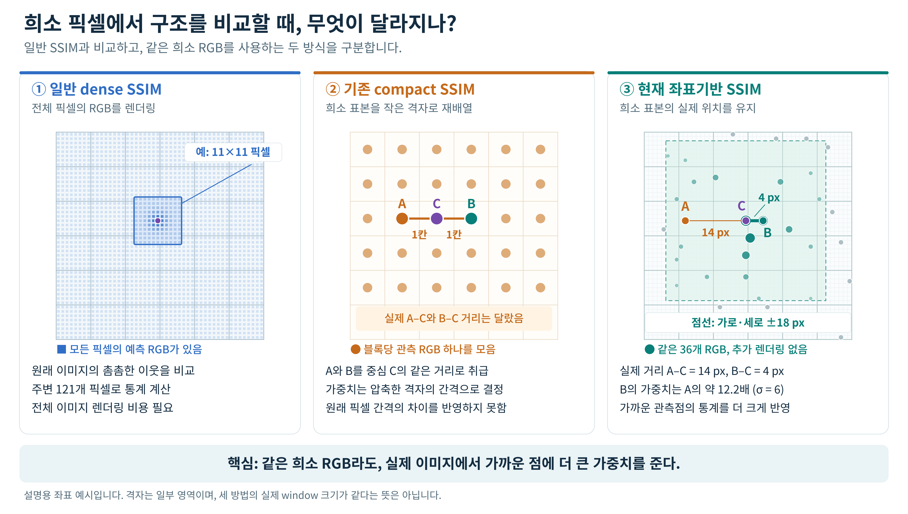

# Sparse GRT 구조손실과 논문 아키텍처

2026-11-01 · 모진수

## 요약

### 발견 1 - vanila gs에서 국소적 위치관계를 파악하는 ssim loss가 sparse 학습에서는 구성이 어렵다는 점을 극복하는 수학적 설계를 발견함  

이는 sampling된 픽셀의 실제 좌표값을 가중치로 반영해 window로 구성해서 계산하는 방식이다. 

이를 통해 유의미한 품질 향상을 확인했다. 주목할 점은 이를 통해 학습시간까지 감소하는 것이다. 

ssim loss와 관련된 연구에서 어려웠던 점이 학습시간이 늘어나는 문제인데 이는 gardient 전파량이 많아져서 그런것이다. 

그러나 이 구조손실이 학습시간이 감소하는 원인은 아직 정확하게 파악하지 못했으나 gaussian의 배치 자체를 학습시간이 감소하는 방향으로 하는 loss인 것으로 추측된다. 

## 1. 좌표기반 구조손실

그림 1. 가운데의 compact SSIM은 기존 sparse학습에서 사용하던 ssim loss를 뜻한다. 

sparse에서 처음에 사용한 ssim loss는(그림에서 compact ssim) sampling된 A와 B가 중심 C에서 모두 한 칸 떨어져 있지만, 실제 이미지에서는 각각 14픽셀과 4픽셀 떨어져 있다. 현재 방식은 이 거리를 반영하므로 sigma가 6픽셀일 때 B의 가중치가 A의 약 12.2배가 된다. 가운데와 오른쪽은 동일한 관측 RGB를 사용한다. 좌표와 점의 수는 설명용 예시이며 실험 결과 이미지가 아니다.

기존 SSIM은 sampling한 픽셀을 작은 격자 이미지로 배열하므로, 원래 이미지에서 픽셀 사이의 실제 간격이 달라도 같은 이웃 관계로 취급한다. 

이를 보완하기 위해 각 관측 픽셀을 중심으로 실제 좌표 거리에 따른 Gaussian 가중치를 부여하는 SSIM형 손실을 구현했다. 

현재는 학습 이미지 기준 sigma를 6픽셀로 두고, 가로·세로 각각 ±18픽셀 범위의 관측점을 이웃으로 사용한다. 예측 RGB와 같은 위치의 GT에 동일한 가중치를 적용해 채널별 평균·variance·covariance를 계산하고, 평균 색상과 국소적인 색 변화의 일치도를 비교한다. 

이미지 경계에서도 존재하는 이웃의 가중치 합이 1이 되도록 정규화한다. Gradient는 각 중심점뿐 아니라 해당 통계에 참여한 모든 관측 이웃의 RGB를 거쳐 Gaussian 파라미터로 전달된다. 추가 Ray나 보조 렌더링은 없으며, 미관측 Ray의 렌더 경로를 직접 학습하는 것은 아니다.

그림 2. 예측과 GT의 같은 위치에 동일한 가중치를 적용해 통계를 비교한다. 각 중심점의 손실은 통계에 참여한 모든 관측 RGB를 거쳐 Gaussian에 전달되며, 겹치는 이웃의 gradient는 합산된다. 

이미지 경계에서는 존재하는 관측 이웃의 가중치를 다시 정규화한다. 일반 SSIM과 compact SSIM도 참여 이웃 전체에 gradient를 전달하므로, 현재 방식의 차이는 실제 좌표에 따른 이웃 구성과 가중치에 있다.

Counter·Bonsai는 DS2, Bicycle은 DS4에서 MV4로 30,000step 학습했다. 동일한 `0.8 L1 + 정규화` 대조군에 `0.2 구조손실`을 추가했을 때 PSNR은 0.20~0.35 dB, SSIM은 0.0095~0.0381 증가했고, LPIPS는 0.0212~0.0596 감소했다. 

상세 수치는 아래와 같다. 

### 좌표기반 구조손실 — Counter·Bonsai·Bicycle 풀학습

### 1. 목적·대조군·실행 식별

동일한 초기 상태·뷰/레이 순서·개수 추이에서 `0.8 L1 + 정규화`와 `0.8 L1 + 0.2 좌표기반 SSIM + 정규화`를 비교한다. 

### 2. 데이터·학습 조건

| 씬 | DS | train / test | MV | 뷰별 block | 총 명목 ray 예산 | 초기 N | 최종 N |
|---|---:|---:|---:|---:|---:|---:|---:|
| Counter | 2 | 210 / 30 | 4 | 8 | 1/16 | 155,767 | 1,229,851 |
| Bonsai | 2 | 255 / 37 | 4 | 8 | 1/16 | 206,613 | 1,209,886 |
| Bicycle | 4 | 169 / 25 | 4 | 6 | 1/9 | 54,275 | 3,021,939 |

각 씬의 gaussian 갯수는 이전에 설계한 mcmc에서의 이미지 복잡도 기반 추정 알고리즘으로 정한 cap으로 학습 한 것이다. 

### 3. 하드웨어·실행 환경

RTX 4090 24GB, driver 580.142, power limit 450W. 단일 GPU에서 순차 실행했다. 

### 4. 최종 결과·평가 방식

| 씬 | 손실 | PSNR ↑ | SSIM ↑ | LPIPS ↓ | 순수 학습시간 |
|---|---|---:|---:|---:|---:|
| Counter | 0.8 L1 | 29.1384 | 0.89646 | 0.27586 | 34분 13초 |
| Counter | 0.8 L1 + 0.2 구조손실 | 29.3406 | 0.90600 | 0.25465 | 27분 37초 |
| Bonsai | 0.8 L1 | 31.9679 | 0.92906 | 0.27277 | 27분 46초 |
| Bonsai | 0.8 L1 + 0.2 구조손실 | 32.3165 | 0.94008 | 0.24849 | 23분 57초 |
| Bicycle | 0.8 L1 | 25.1471 | 0.72380 | 0.32408 | 45분 19초 |
| Bicycle | 0.8 L1 + 0.2 구조손실 | 25.3776 | 0.76190 | 0.26451 | 35분 18초 |

### 6. 시간·메모리와 측정 범위

표의 시간은 CUDA 동기화를 포함한 학습 스텝 합계다. 입력 준비·forward·loss·backward·Adam·MCMC·BVH가 포함되며, 초기 cap 산출·설정·평가·체크포인트 저장은 별도로 기록했다. 구조손실군의 학습시간 감소는 Counter 19.26%, Bonsai 13.75%, Bicycle 22.11%다. 

**loss 를 추가하는 것으로 품질은 올라가면서 학습시간은 유의미하게 감소하는 것도 큰 발견이라고 생각되긴한다. 이유는 mcmc가 기존 vanila 대비 gaussian의 배치가 학습시간을 늘리는 방향으로 학습되는 것인데 이를 완화해주는 것이 아닌가라고 추측된다.**

이는 조금 더 명확하게 파악해야할 여지이다. 

### 7. 해석·한계

세 씬 모두 PSNR·SSIM·LPIPS가 개선됐다. 최종 PSNR 변화는 +0.2022 / +0.3486 / +0.2306dB, SSIM은 +0.00954 / +0.01102 / +0.03811, LPIPS는 −0.02121 / −0.02428 / −0.05956이다. 씬별 한 seed 결과이며 반복 통계는 없다. 

## 2. 논문 아키텍처 구상

Gaussian Ray Tracing(grt)은 다양한 카메라와 렌더링 조건을 지원하지만, 학습에 필요한 ray 처리 비용이 크다. 그래서 전체 픽셀의 일부만 sampling하면 계산량을 줄일 수 있으나, 기존 Gaussian 학습 파이프라인을 그대로 적용할 경우 품질 저하와 과도한 Gaussian 증가가 발생한다.

먼저 희소 ray sampling에 따른 gradient 분산이 Gaussian별 gradient norm을 부풀리는 현상을 분석하고, 이 통계량을 사용하는 densification이 sampling ray수에 민감해짐을 보인다. 이를 바탕으로 gradient norm에 의존하지 않는 기존 MCMC 용량 관리 방식을 도입하고, 입력 이미지의 특성으로 장면별 Gaussian 예산을 설정한다.

품질 회복을 위해서는 고정된 총 ray 예산을 여러 뷰에 분배한다. 

또한 관측 픽셀의 실제 이미지 좌표로 이웃 관계를 구성하는 구조손실을 적용한다. 이 손실은 추가 ray나 미관측 픽셀의 렌더링 없이, 관측된 픽셀 사이의 색 변화와 국소 통계를 GT와 비교한다. 이를 통해 희소 표집의 계산상 이점을 유지하면서 재구성 품질과 구조적 유사도를 개선하는 GRT 학습 파이프라인을 구성한다.

**결론적으로 원 grt 대비 우리 아키텍처는 sparse ray + mcmc + 이미지 복잡도 기반 갯수 추정 + muliti-view + 좌표기반 구조손실로 vanila GS와 거의 동등한 학습 품질을 가지며 grt대비 4배 정도 빠르게 된다.**
