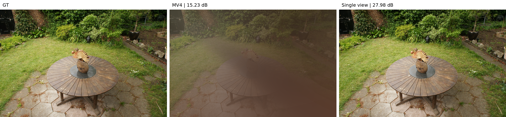
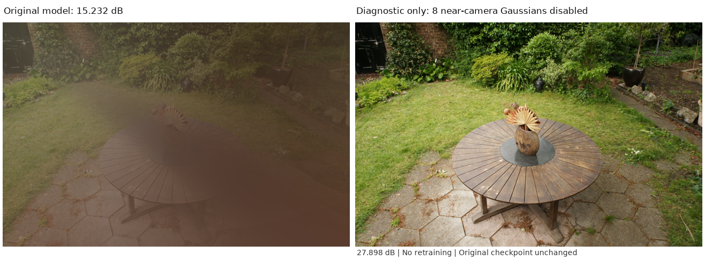

# 구조손실의 13씬 품질·학습시간과 Garden 가림 현상

2026-11-03 · 모진수 · 30,000step 완료 결과 기준

## 요약

### 발견 1. 구조손실을 추가한 13씬에서 SSIM과 LPIPS가 모두 개선됐다

같은 Ray 예산의 L1-only와 L1 + 좌표기반 구조손실을 비교했다. 표의 13씬 모두 SSIM은 증가하고 LPIPS는 감소했다. PSNR은 11씬에서 증가했지만 Flowers는 0.263 dB, Garden은 0.368 dB 감소했다. 

### 발견 2. 구조손실의 학습시간 효과는 씬마다 다르다

같은 인스턴스에서 비교한 12씬 중 10씬은 학습시간이 2.63~22.11% 감소했다. Stump는 6.79%, Treehill은 11.70% 증가했다. 구조손실 추가가 항상 학습을 가속하는 것은 아니다. 각 씬의 두 손실 조건은 Gaussian 개수 추이를 같게 설정했으므로, 시간 차이를 최종 개수 차이로 설명할 수 없다.

### 발견 3. Garden의 큰 PSNR 하락은 특정 test view의 근접 Gaussian 가림에 집중됐다

총 Ray 예산을 1/16로 유지하고 MV4를 단일뷰로 바꾸면 문제 뷰 PSNR은 15.23 dB에서 27.98 dB로 회복됐다. 다만 나머지 23뷰 평균 PSNR은 0.4613 dB 감소했다. MV4를 유지하고 총 Ray를 1/9로 증가시킨 동일 장비 실험에서는 전체 PSNR이 26.1428 dB에서 26.9558 dB로 증가했고 학습시간은 11.56% 증가했다. 단일 seed 결과이므로 이 설정이 가림을 항상 방지한다고 결론짓지는 않는다.

## 1. 구조손실의 품질과 학습시간

### 1.1 비교 조건

Sparse GRT + 입력 이미지 기반 Gaussian cap + MCMC + MV4를 사용했다. SfM 초기화 seed는 777이며 처음부터 30,000step을 학습했다. 초기 Gaussian 수에서 입력 cap까지 5,000step 동안 같은 성장 계획을 적용하고 이후 개수를 고정했다.

L1-only는 `0.8 L1 + 정규화`, 구조손실 조건은 `0.8 L1 + 0.2 좌표기반 구조손실 + 같은 정규화`다. 구조손실은 학습 이미지 좌표에서 sigma 6픽셀, 가로·세로 각각 ±18픽셀의 관측 이웃을 사용한다. 추가 Ray나 보조 렌더링은 없다. Opacity와 scale 정규화 계수는 각각 0.01이다.

해상도는 학습에 사용한 가로×세로 픽셀 수다. DS는 데이터 로딩 시 적용한 downsampling 배율이며 DS1은 추가 downsampling을 하지 않은 설정이다. 총 Ray는 네 뷰를 합친 step당 실제 수다. 뷰당 수는 총합의 1/4이며 경계 block을 포함하므로 명목 비율과 조금 다르다. Kitchen·Bicycle·Train은 기존 실험부터 1/9였으며, 나머지는 1/16이다.

전체 test view를 GRT로 평가했다. PSNR은 이미지별 평균, SSIM은 TorchMetrics(data_range=1), LPIPS는 VGG(normalize=True)를 사용했다. 아래 품질 값은 PSNR↑ / SSIM↑ / LPIPS↓ 순서이며 지표별 좋은 값을 굵게 표시했다.

### 1.2 씬별 품질

| 씬 | 학습 해상도 · DS | 총 Ray/step | L1-only | L1 + 구조손실 | L1 + sparse SSIM |
|---|---:|---:|---|---|---|
| Counter | 1558×1038 · DS2 | 101,400 · 1/16 | 29.138 / 0.8965 / 0.2759 | **29.355** / **0.9062** / **0.2544** | 29.268 / 0.9021 / 0.2600 |
| Room | 1557×1038 · DS2 | 101,400 · 1/16 | 31.062 / 0.9028 / 0.3330 | **31.639** / **0.9191** / **0.2965** | 31.566 / 0.9171 / 0.3004 |
| Bonsai | 1559×1039 · DS2 | 101,400 · 1/16 | 31.968 / 0.9291 / 0.2728 | 32.316 / **0.9401** / **0.2485** | **32.324** / 0.9382 / 0.2515 |
| Kitchen | 1558×1039 · DS2 | 180,960 · 1/9 | 32.006 / 0.9208 / 0.1710 | **32.159** / **0.9271** / **0.1586** | 31.905 / 0.9258 / 0.1600 |
| Bicycle | 1237×822 · DS4 | 113,436 · 1/9 | 25.147 / 0.7238 / 0.3241 | **25.378** / **0.7619** / **0.2645** | 25.364 / 0.7595 / 0.2687 |
| Flowers | 1256×828 · DS4 | 65,312 · 1/16 | **22.011** / 0.5969 / 0.3821 | 21.748 / **0.6118** / **0.3531** | 21.827 / 0.6086 / 0.3581 |
| Garden | 1297×840 · DS4 | 68,460 · 1/16 | **26.511** / 0.7936 / 0.2503 | 26.143 / **0.8059** / **0.2135** | — · 1/9 결과는 아래 행 |
| Garden · 1/9 추가 | 1297×840 · DS4 | 121,520 · 1/9 | 26.851 / 0.8132 / 0.2197 | **26.956** / **0.8370** / **0.1776** | 26.637 / 0.8303 / 0.1828 |
| Stump | 1245×825 · DS4 | 64,896 · 1/16 | 26.833 / 0.7797 / 0.2799 | 27.076 / **0.7923** / **0.2502** | **27.100** / 0.7907 / 0.2552 |
| Treehill | 1267×832 · DS4 | 66,144 · 1/16 | 22.973 / 0.5917 / 0.4797 | 23.113 / 0.6305 / 0.4000 | **23.189** / **0.6326** / **0.3992** |
| Train | 980×545 · DS1 | 59,696 · 1/9 | 21.478 / 0.7799 / 0.2921 | 21.752 / **0.8129** / **0.2387** | **21.862** / 0.8116 / 0.2442 |
| Truck | 979×546 · DS1 | 33,948 · 1/16 | 24.426 / 0.8447 / 0.2417 | **24.795** / **0.8667** / **0.1991** | 24.648 / 0.8604 / 0.2057 |
| DrJohnson | 1332×876 · DS1 | 73,480 · 1/16 | 29.690 / 0.9031 / 0.3317 | **30.105** / **0.9082** / **0.3151** | 30.002 / 0.9075 / 0.3163 |
| Playroom | 1264×832 · DS1 | 65,728 · 1/16 | 30.594 / 0.9051 / 0.3356 | **30.876** / **0.9099** / **0.3203** | 30.861 / 0.9085 / 0.3234 |

Counter의 구조손실 29.3549 / 0.90617 / 0.25441은 새 환경의 재현 실행이다. 기존 L1과 같은 장비에서 실행한 구조손실 결과는 29.3406 / 0.90600 / 0.25465이며, 이 쌍의 PSNR 차이는 +0.2022 dB다. 기존 표의 값을 유지하기 위해 두 실행을 구분해 남긴다.

Garden의 평균은 가림이 발생한 뷰를 포함한 전체 24뷰 그대로다. Flowers의 PSNR 감소와 Garden의 가림 현상을 같은 원인으로 확정하지 않았다. 모든 값은 단일 seed 결과이며 통계적 유의성은 검증하지 않았다.

### 1.3 씬별 학습시간

시간 변화는 `(구조손실 시간 / L1 시간 − 1) × 100`이며 음수는 시간 감소다.

| 씬 | L1-only 학습시간 | L1 + 구조손실 학습시간 | L1 + sparse SSIM 학습시간 | 좌표 구조손실 / L1 시간 변화 |
|---|---:|---:|---:|---:|
| Counter | 34분 13초 | 28분 50초 | 27분 45초 | -17.7% |
| Room | 28분 14초 | 22분 17초 | 21분 53초 | -21.10% |
| Bonsai | 27분 46초 | 23분 57초 | 23분 18초 | -13.75% |
| Kitchen | 50분 07초 | 43분 03초 | 39분 56초 | -14.11% |
| Bicycle | 45분 19초 | 35분 18초 | 33분 57초 | -22.11% |
| Flowers | 30분 49초 | 28분 53초 | 30분 28초 | -6.27% |
| Garden | 27분 53초 | 23분 00초 | — · 1/9 결과는 아래 행 | -17.53% |
| Garden · 1/9 추가 | 33분 11초 | 25분 39초 | 26분 21초 | -22.70% |
| Stump | 36분 26초 | 38분 54초 | 50분 03초 | +6.79% |
| Treehill | 34분 29초 | 38분 32초 | 35분 44초 | +11.70% |
| Train | 23분 38초 | 22분 39초 | 22분 03초 | -4.19% |
| Truck | 18분 43초 | 18분 13초 | 17분 26초 | -2.63% |
| DrJohnson | 37분 35초 | 30분 48초 | 30분 58초 | -18.06% |
| Playroom | 27분 45초 | 24분 09초 | 23분 29초 | -12.95% |

같은 cap에서도 학습시간이 달라진다는 점은 Gaussian 배치와 Ray–Gaussian 적중량, BVH 처리 비용을 함께 분석할 이유가 된다. 이번 결과만으로 시간 감소의 직접 원인을 특정하지 않는다. 구조손실 커널 자체가 L1-only보다 계산을 덜 한다는 의미도 아니다.

## 2. Garden의 가림 현상과 Ray 예산 비교

### 2.1 특정 test view에서 나타난 가림

그림 1. Garden의 DSC08140.JPG. 왼쪽은 GT, 가운데는 MV4·총 Ray 1/16, 오른쪽은 단일뷰·총 Ray 1/16이다. 두 학습 모두 MCMC와 `0.8 L1 + 0.2 구조손실`, DS4, Gaussian cap 2,044,672개를 유지했다. 각각 처음부터 학습한 30k 모델이며, 그림은 Gaussian을 사후 삭제하거나 색을 보정한 결과가 아니다.

기여도가 큰 Gaussian 5개의 opacity만 진단상 비활성화하면 문제 뷰 PSNR이 27.8881 dB로 회복됐다. 이 조작은 렌더링 원인 확인에만 사용했고 공식 품질 표나 학습 모델에는 반영하지 않았다.

### 2.2 확인된 생성·생존 경로와 남은 가설

7k checkpoint에서 동일 RNG·optimizer·뷰 순서로 30k까지 재실행한 결과가 원본 최종 파라미터와 비트 단위로 일치했다. 문제 집단 8개는 17,801~24,301step의 재배치에서 카메라 근처 부모로부터 복사됐으며, 이 구간에는 ADD가 없었다.

주요 두 Gaussian은 최종 상태에서 161개 학습 카메라 중 3개에만 기여하지만, 문제 test view에서는 두 개 모두 화면 전체에 기여했다. 평균 합성 가중치의 합은 약 66.7%였다. 재배치 후 관측이 드문 동안에도 Adam의 누적 모멘트에 의해 opacity가 증가한 구간을 확인했다. 높은 opacity에서는 현재 MCMC의 위치 noise가 억제되고 재배치 후보에서도 제외된다.

직접 확인한 것은 근접 Gaussian의 가림과 해당 개체의 재배치·생존 이력이다. 부모가 처음 그 위치에 배치된 원인, MV4와 구조손실이 실패 빈도에 미치는 영향은 아직 분리하지 못했다. Truck의 L1-only에서도 근접 개체의 가림이 확인돼 구조손실만의 문제로 일반화할 수 없다.

### 2.3 단일뷰 전환과 Ray 예산 증가

아래 세 조건은 같은 8번 인스턴스에서 처음부터 30k를 학습했다. cap·성장 계획·MCMC·손실 계수를 유지했다. 문제 뷰를 제외한 평균은 원인 분석용이며, 공식 품질은 항상 전체 24뷰 기준이다.

| 학습 조건 | 총 Ray/step | 전체 24뷰 PSNR / SSIM / LPIPS | 문제 뷰 PSNR | 나머지 23뷰 PSNR | 학습시간 |
|---|---:|---|---:|---:|---:|
| MV4 · 1/16 | 68,460 | 26.1428 / 0.80587 / 0.21355 | 15.2317 | 26.6172 | 23분 00초 |
| 단일뷰 · 1/16 | 68,250 | 26.2319 / 0.81865 / 0.20351 | 27.9800 | 26.1559 | 21분 01초 |
| MV4 · 1/9 | 121,520 | 26.9558 / 0.83698 / 0.17757 | 28.2596 | 26.8991 | 25분 39초 |

단일뷰에서는 그림 1의 가림이 사라졌지만, 나머지 23뷰 중 22뷰에서 MV4의 PSNR이 높았다. 단일뷰 전체 전환이 모든 뷰에 유리하다는 결과는 아니다. 경계 block 차이로 단일뷰의 실제 총 Ray는 MV4보다 210개, 약 0.307% 적다.

MV4·1/9는 같은 장비의 MV4·1/16보다 전체 PSNR이 0.8130 dB, SSIM이 0.03111 증가하고 LPIPS가 0.03598 감소했다. 문제 뷰를 제외한 23뷰 평균도 0.2819 dB 증가했다. 학습시간은 23분 00초에서 25분 39초로 11.56% 증가했다. 문제 뷰의 평가값은 회복됐으나, 이 새 모델의 개체별 가림 기여도 검사는 별도로 수행하지 않았다.

고정 총 Ray 예산을 네 뷰에 나누면 뷰당 관측 밀도가 낮아진다. 단일뷰 전환과 Ray 증가 결과는 이 밀도의 영향을 지지한다.

### 2.4 이미지별 MV4·단일뷰 PSNR

두 모델 모두 총 Ray 예산 1/16, MCMC, L1 + 구조손실로 처음부터 학습한 30k 결과다. 아래 표는 테스트 이미지 24장을 빠짐없이 비교한 것이다. 차이는 `MV4 − 단일뷰`이며, 단위는 dB다. Gaussian 제거 전의 원본 모델을 사용했다.

| 테스트 이미지 | MV4 PSNR | 단일뷰 PSNR | 차이 |
|---|---:|---:|---:|
| DSC07956.JPG | 23.6388 | 22.4154 | +1.2234 |
| DSC07964.JPG | 22.6295 | 22.0252 | +0.6044 |
| DSC07972.JPG | 26.9190 | 26.1789 | +0.7401 |
| DSC07980.JPG | 23.8104 | 23.1348 | +0.6756 |
| DSC07988.JPG | 20.0882 | 18.5341 | +1.5540 |
| DSC07996.JPG | 26.7442 | 25.7051 | +1.0390 |
| DSC08004.JPG | 28.8168 | 28.1592 | +0.6576 |
| DSC08012.JPG | 28.0104 | 27.1259 | +0.8844 |
| DSC08020.JPG | 26.1359 | 25.8462 | +0.2898 |
| DSC08028.JPG | 27.2980 | 26.5022 | +0.7958 |
| DSC08036.JPG | 27.1451 | 26.6443 | +0.5008 |
| DSC08044.JPG | 27.6750 | 27.4174 | +0.2576 |
| DSC08052.JPG | 26.6758 | 26.4180 | +0.2578 |
| DSC08060.JPG | 29.0229 | 28.7814 | +0.2416 |
| DSC08068.JPG | 29.2583 | 29.1458 | +0.1125 |
| DSC08076.JPG | 25.3681 | 25.3196 | +0.0486 |
| DSC08084.JPG | 27.3068 | 27.1761 | +0.1307 |
| DSC08092.JPG | 29.3011 | 29.0023 | +0.2989 |
| DSC08100.JPG | 27.3739 | 27.0555 | +0.3184 |
| DSC08108.JPG | 28.3139 | 28.2130 | +0.1009 |
| DSC08116.JPG | 28.4998 | 28.4498 | +0.0500 |
| DSC08124.JPG | 25.7356 | 25.7206 | +0.0150 |
| DSC08132.JPG | 26.4277 | 26.6142 | -0.1865 |
| DSC08140.JPG · 가림 발생 | 15.2317 | 27.9800 | -12.7483 |
| 전체 24장 평균 | 26.1428 | 26.2319 | -0.0891 |
| 문제 뷰를 제외한 23장 평균 · 진단용 | 26.6172 | 26.1559 | +0.4613 |

MV4는 24장 중 22장에서 단일뷰보다 PSNR이 높았다. DSC08132.JPG에서는 0.1865 dB 낮았고, 가림이 발생한 DSC08140.JPG에서는 12.7483 dB 낮았다. 이 한 장의 큰 차이 때문에 전체 평균에서는 단일뷰가 0.0891 dB 높게 나타났다.

학습 이미지에서는 기존 진단에 포함된 3장을 비교했다. 전체 학습 이미지 161장의 결과는 아니며, 다음 표로 전체 학습 품질의 우열을 판단하지 않는다.

| 학습 이미지 · 진단 대상 | MV4 PSNR | 단일뷰 PSNR | 차이 |
|---|---:|---:|---:|
| DSC08055.JPG | 29.5348 | 29.4196 | +0.1152 |
| DSC08114.JPG | 28.0004 | 27.9864 | +0.0140 |
| DSC08139.JPG | 29.1674 | 29.1775 | -0.0101 |

이 3장의 차이는 −0.0101~+0.1152 dB로, 문제 테스트 이미지의 12.7483 dB 차이보다 작았다. 문제 개체가 학습 카메라에서는 작은 영역에 기여하고 특정 테스트 카메라에서 화면을 크게 가린다는 앞선 기여도 분석과 함께 해석할 수 있다.

### 2.5 문제 Gaussian 제거 전후 비교

같은 MV4 checkpoint에서 문제 개체의 opacity를 거의 0으로 설정해 렌더링 기여를 제거했다. 파일에서 개체를 삭제하거나 재학습한 실험은 아니며, 다른 파라미터는 그대로 유지했다. 아래 값은 모두 DSC08140.JPG 한 장의 PSNR이다.

| 모델·조작 | PSNR (dB) | 해당 모델의 제거 전 대비 |
|---|---:|---:|
| MV4 원본 | 15.2317 | — |
| MV4 · 기여 상위 문제 개체 5개 제거 | 27.8881 | +12.6564 |
| MV4 · 근접 문제 집단 8개 제거 | 27.8984 | +12.6666 |
| 단일뷰 원본 · 별도로 학습한 비교 모델 | 27.9800 | — |

그림 2. 왼쪽은 MV4 원본(15.2317 dB), 오른쪽은 동일 모델에서 근접 문제 Gaussian 8개의 기여만 제거한 결과(27.8984 dB)다. 제거 후 갈색 가림이 사라졌다. 그림 1의 단일뷰 모델과 달리 학습 조건이나 학습 경로를 변경하지 않은 진단이다.

5개 제거로 12.6564 dB 회복됐고, 근접 집단 8개를 제거했을 때의 추가 회복은 0.0102 dB였다. opacity를 복원하면 원본 렌더링으로 돌아왔으며, 5개 제거 진단에서 복원 이미지와 원본의 최대 픽셀 차이는 0이었다.

근접 집단 8개를 동일하게 제거한 상태에서, 기존 진단에 포함된 학습 이미지 4장과 테스트 이미지 2장도 비교했다. 다음 표는 이 6장의 실측값이며, 상위 5개만 제거한 결과와 구분한다.

| 구분 | 이미지 | MV4 원본 PSNR | 8개 제거 후 PSNR | 변화 (dB) |
|---|---|---:|---:|---:|
| 테스트 · 문제 뷰 | DSC08140.JPG | 15.231739 | 27.898369 | +12.666630 |
| 테스트 | DSC08108.JPG | 28.313915 | 28.313925 | +0.000010 |
| 학습 | DSC08055.JPG | 29.534805 | 29.534796 | -0.000010 |
| 학습 | DSC08113.JPG | 29.353668 | 29.353661 | -0.000008 |
| 학습 | DSC08114.JPG | 28.000410 | 28.000343 | -0.000067 |
| 학습 | DSC08139.JPG | 29.167440 | 29.167442 | +0.000002 |

문제 뷰를 제외한 이 5장에서는 PSNR 변화의 절댓값이 0.000067 dB 이하였다. 다만 주요 문제 개체가 실제 기여하는 것으로 확인된 학습 이미지 DSC07971·DSC07974·DSC07975는 위 제거 전후 평가에 포함되지 않았다. 따라서 전체 학습 이미지에서 손실 없이 제거할 수 있다고 결론짓지는 않는다.

위 제거 결과는 가림 원인을 확인하기 위한 진단이며, 테스트 이미지에서 문제를 확인한 뒤 대상을 정했다. 공식 벤치마크 수치나 자동 제거 알고리즘의 성능으로 사용하지 않는다. 8개 제거 후 전체 24장 평균도 별도로 측정하지 않았으므로 기존 공식 평균을 교체하지 않는다.

