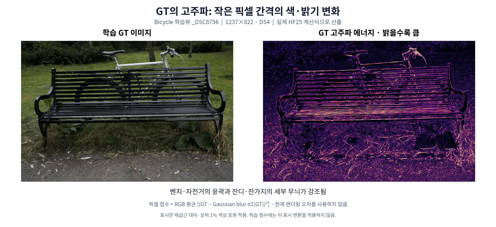
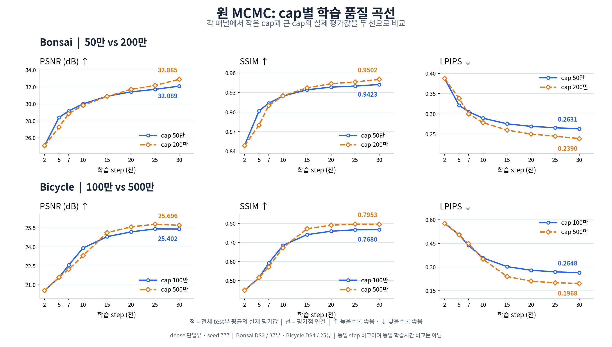
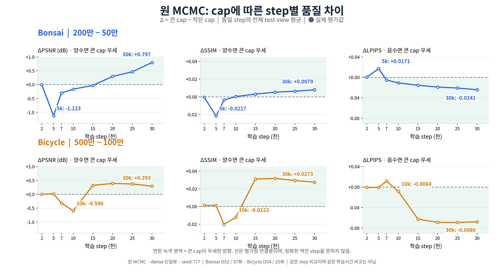

# 원 GS-MCMC cap별 프로파일 및 HF25 비교

## 1. 실험 설정

두 씬에서 Gaussian cap을 단계적으로 바꾸고, **각 cap마다 원 MCMC(opacity 기반)와 HF25를 비교**했다. 총 **7쌍·14회 학습**이며, cap은 자동 추정값이 아닌 사전에 지정한 개수 상한이다.

| 씬 | 학습·평가 해상도 · DS | cap (만 개) | 실행 수 |
| --- | --- | --- | --- |
| Bonsai | 1559×1039 · **DS2** | **50 / 100 / 150 / 200** | 4 cap × 2조건 = 8 |
| Bicycle | 1237×822 · **DS4** | **100 / 300 / 500** | 3 cap × 2조건 = 6 |

- **학습:** 원 GS rasterizer + 원 MCMC, dense 단일뷰(K=1), SfM 초기화, seed 777, 30,000 step. 씬별 동일 RTX 4090 인스턴스에서 실행했다.
- **성장:** 600–24,900 step에 100 step마다 재배치 후 현재 개수의 5%를 cap까지 추가했다. cap 도달 step은 강제하지 않았으며, 25k부터 ADD·재배치를 모두 종료했다.
- **손실:** 0.8 L1 + 0.2(1−SSIM), opacity·scale 정규화 각각 0.01. Adam·학습률·위치 noise는 원 설정을 유지했다.
- **기록:** 100 step마다 고정 학습뷰 8장의 프로파일을 기록했다. 전체 test뷰의 PSNR·SSIM(torchmetrics)·LPIPS(VGG)는 2k·5k·7k·10k·15k·20k·25k·30k에 평가했다.

## 2. HF25: GT 고주파 정보를 재배치 donor 선택에 25% 혼합

**Donor는 재배치할 Gaussian이 파라미터를 복사받는 원본 Gaussian**이다. 원 MCMC는 살아 있는 후보(opacity > 0.005) 중 opacity가 큰 Gaussian을 더 자주 선택한다. HF25는 이 기본 확률을 유지하면서, **GT에서 세밀한 색·밝기 변화가 있는 영역에 기여하는 Gaussian의 선택 확률을 높인다.** 변경한 것은 재배치 donor 선택뿐이며, **ADD는 기존 opacity 기반 선택을 그대로 사용**했다.

원 선택확률을 $q_i$, 평균 대비 고주파 점수를 $r_i$라 두면:

$$
q_i=\frac{\alpha_i}{\sum_j\alpha_j},\qquad
p_i^{\mathrm{HF25}}=0.75q_i+0.25q_i r_i
$$

$r_i$는 해당 Gaussian의 고주파 점수를 **유효한 점수를 가진 후보들의 opacity 가중 평균**으로 나눈 값이다. 점수가 없는 후보는 중립값 1을 사용한다. 따라서 **25%는 확률의 혼합 비중**이며, 상위 25% Gaussian만 고른다는 뜻이 아니다.

| 상대 고주파 점수 $r_i$ | 기존 선택확률 대비 HF25 |
| --- | --- |
| 0: 고주파 변화가 없음 | 0.75배 |
| 1: 평균 수준 | 1배 |
| 3: 평균의 3배 | 1.5배 |

**GT 고주파**는 학습 GT와 이를 Gaussian blur(σ=1 학습 픽셀)한 영상의 차이를 제곱하고 RGB 채널 평균한 값이다. 벤치·자전거의 윤곽, 잔디·잔가지처럼 작은 픽셀 간격에서 색이 변하는 부분이 크게 나타난다.

*그림 1. 실제 점수 계산에 사용된 Bicycle 학습뷰를 같은 계산식으로 시각화했다. 오른쪽은 밝을수록 GT 고주파 에너지가 높다. 표시용 대비 조정은 학습 점수에 적용하지 않았다.*

이 픽셀 점수를 각 Gaussian의 **실제 합성 기여 가중치(Tα)**로 평균하여 Gaussian별 점수를 만든다. 500 step마다 순환 학습뷰 4장으로 갱신한다. 새로 관측되지 않은 개체는 이전 유효 점수를 유지하고, 재배치·ADD로 생성된 개체는 donor 점수를 상속한다. **현재 렌더링 오차를 사용한 점수가 아니므로, 이미 잘 복원된 영역도 GT가 복잡하면 높은 점수를 받을 수 있다.**

## 3. cap 증가에 따른 학습 중 품질 차이

**원 MCMC끼리 cap만 바꾼 비교**다. Bonsai는 **50만 vs 200만**, Bicycle은 **100만 vs 500만**을 비교한다. 각 패널에 작은 cap(파란 실선)과 큰 cap(주황 점선)의 **실제 PSNR·SSIM·LPIPS 값 두 선**을 겹쳐 표시했다. PSNR·SSIM은 높을수록, LPIPS는 낮을수록 좋다.

*원수치 비교. 전체 test뷰 평균을 2k·5k·7k·10k·15k·20k·25k·30k에서 비교했다. 점은 실제 평가값이며 선은 연결용이다. 각 선 끝에는 30k 값을 표시했다. SSIM은 torchmetrics, LPIPS는 VGG 기준이다.*

다음 그림은 위 두 곡선의 **큰 cap − 작은 cap** 차이를 보여준다. PSNR·SSIM은 양수, LPIPS는 음수일 때 큰 cap이 우세하다.

*그림 2. 전체 test뷰 평균의 차이를 같은 평가 step에서 비교했다. 점은 실제 평가값이며 선은 연결용이다. 녹색 영역은 큰 cap이 우세한 방향이다.*

아래 표의 Δ는 **큰 cap − 작은 cap**이다.

| 큰 cap − 작은 cap | 초기 ΔPSNR | 30k ΔPSNR | 30k ΔLPIPS |
| --- | ---: | ---: | ---: |
| Bonsai 200만 − 50만 | 5k: **−1.123 dB** | **+0.797 dB** | **−0.0241** |
| Bicycle 500만 − 100만 | 10k: **−0.596 dB** | **+0.293 dB** | **−0.0680** |

- **Bonsai:** 5k에는 세 지표 모두 큰 cap이 열세였다. 이후 LPIPS는 7k, SSIM은 10k, PSNR은 20k 평가에서 우세로 전환됐다. 지표별로 이득이 나타나는 시점이 달랐다.
- **Bicycle:** 7k에는 세 지표 모두 큰 cap이 열세였다. LPIPS는 10k에 우세로 전환됐고, PSNR·SSIM은 15k부터 우세했다. 30k에는 PSNR +0.293 dB, SSIM +0.0273, LPIPS −0.0680의 차이가 남았다.

같은 step 비교이며 학습시간은 같지 않다. 단일 seed의 관측으로, cap 증가에 따른 성장 이력과 최적화 경로의 영향을 분리한 결과는 아니다.

## 4. SalientGS: 렌더링 오차를 이용한 Gaussian 배분

SalientGS는 **현재 렌더링과 학습 GT의 RGB L1 오차**를 이용해, 아직 잘 복원하지 못한 영역에 Gaussian을 더 배분한다. 여러 학습뷰의 오차를 분위수로 정규화한 뒤 큰 오차에 가중치를 주고, Gaussian의 투영 영역과 여러 뷰에서 평균하여 **복원 부족 점수 $s_i$**를 만든다. Donor 선택 확률은 다음 형태다.

$$
p_i\propto\big[(1-\lambda)\alpha_i+\lambda\big]\,
\operatorname{softplus}\!\left(\frac{s_i-\tau}{\tau}\right)
$$

즉, **오차가 큰 영역에 걸친 Gaussian을 더 자주 선택**하고, opacity가 낮아도 선택 가능성을 확보한다. $\tau$는 중요도 기준, $\lambda$는 opacity 의존도를 완화하는 계수이며, HF25처럼 두 확률을 75:25로 섞는 방식은 아니다.

이 확률은 **재배치 donor와 ADD의 부모 선택 모두**에 적용한다. 또한 낮은 오차 영역의 별도 ‘중복도’ 점수를 사용해, opacity가 낮은 Gaussian뿐 아니라 중복도가 높은 Gaussian도 재배치 대상으로 삼는다. 따라서 donor 확률만 바꾸는 모듈보다 변경 범위가 넓다. [원문 §3.3, 식 (2)–(9)](https://arxiv.org/html/2607.11285v1#S3.SS3)

**HF25는 ‘GT 자체가 복잡한 곳’, SalientGS는 ‘현재 모델이 잘 못 맞추는 곳’을 우선한다.** 예를 들어 HF25는 잘 복원된 잔디에도 높은 점수를 줄 수 있고, SalientGS는 무늬가 적어도 상대적으로 오차가 큰 벽을 우선할 수 있다.
