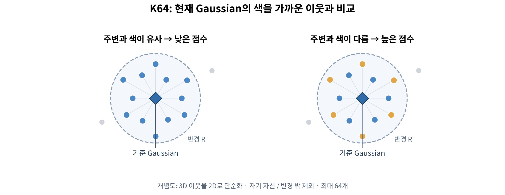
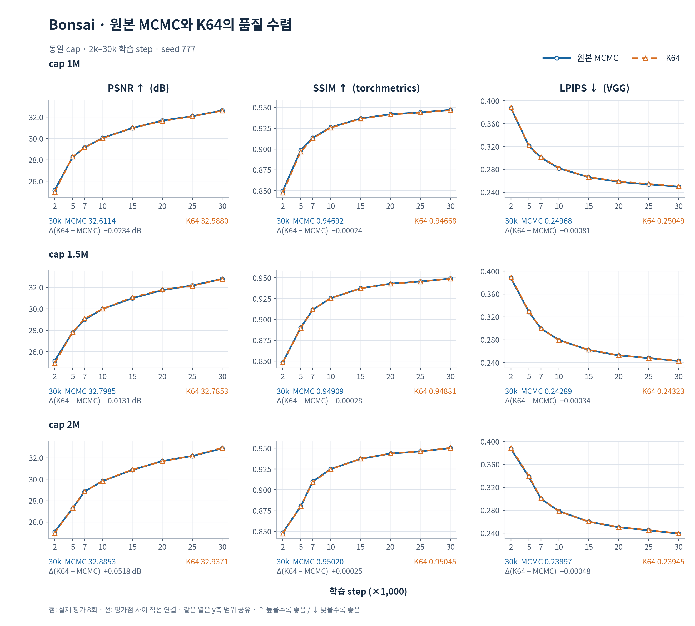
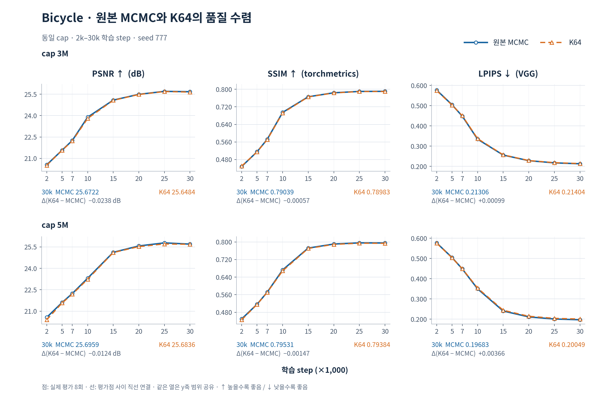

# 원 GS-MCMC: K64 색 대비 기반 가우시안 선택 비교

> 2026-11-22 · Bonsai 3개 cap, Bicycle 2개 cap의 **30k 완료 결과**. 기존 원 MCMC와 같은 cap끼리 비교한다. K64는 현재 Gaussian의 공간 이웃 간 색 대비를 재배치 가우시안 확률에 25% 혼합한 방법이다.

## 1. 실험 설정

| 씬 | 학습·평가 해상도 | 비교 cap = 최종 Gaussian 수 | RTX 4090 인스턴스 |
|---|---|---|---|
| Bonsai | DS2, 1559 × 1039 | 100만 · 150만 · 200만 | 61206849 |
| Bicycle | DS4, 1237 × 822 | 300만 · 500만 | 61206865 |

- **비교:** 원 MCMC 5개 실행과 K64 5개 실행, 총 5쌍. HF25는 §4에서 같은 cap의 기존 실행을 보조 비교한다.
- **학습:** 원 GS rasterizer + 원 MCMC, 전체 픽셀·단일뷰(K=1), SfM 초기화, seed 777, 30,000 step. 희소 ray 실험은 아니다.
- **성장·재배치:** 600–24,900 step에서 100 step마다 수행. 현재 개수의 5%씩 cap까지 ADD하며 cap 도달 시점을 강제하지 않는다. 25k부터 ADD·재배치 모두 종료한다. 원 MCMC와 K64의 cap 도달 step은 동일하다: Bonsai 3,800 / 4,600 / 5,200, Bicycle 8,800 / 9,800.
- **손실·최적화:** 0.8 L1 + 0.2(1−SSIM), 전체 Gaussian에 opacity·scale 정규화 각 0.01. 원 Adam·학습률·위치 noise 설정을 유지한다.
- **평가·프로파일:** 2k·5k·7k·10k·15k·20k·25k·30k에 전체 test view 평가. SSIM은 torchmetrics, LPIPS는 VGG이다. 별도로 고정 학습뷰 8장의 상세 프로파일을 100 step마다 기록했다.

## 2. K64: 재배치 위치로 선택될 gaussian에 대해 가까운 Gaussian과 색이 다를 때 확률 추가

원 MCMC는 살아 있는 Gaussian의 opacity에 비례해 재배치가 될 위치의 가우시안을 뽑는다. K64는 여기에 **현재 모델 안에서 주변과 색이 다른 정도**를 추가한다. 재배치 가우시안 확률만 바꾸며, **ADD의 부모 선택은 원 opacity 방식 그대로**다.

*그림 1. 실제 장면 측정이 아닌 개념도. 가까운 Gaussian들의 색이 비슷하면 낮은 점수, 다른 색이 섞여 있으면 높은 점수를 준다. 그림은 가독성을 위해 이웃 수를 줄여 표시했다.*

**점수 계산.** Opacity > 0.005인 Gaussian들 중, 자기 자신을 제외하고 반경 안의 가장 가까운 이웃을 **최대 64개** 선택한다. 반경은 Bonsai **0.06**, Bicycle **0.10**이며, 각 장면의 world 좌표 단위다. 장면 간 같은 물리적 길이를 의미하지 않는다.

$$
h_i = \frac{1}{|\mathcal N_i|}\sum_{j\in\mathcal N_i}\frac{1}{3}\|c_i-c_j\|_2^2,
\qquad c_i=0.28209479\,f_{i,\mathrm{DC}}+0.5.
$$

여기서 색은 SH의 DC 계수를 RGB로 변환한 값이며 clamp하지 않는다. **GT, 렌더링 잔차, gradient, 상위 SH 계수는 점수에 사용하지 않는다.** 따라서 K64의 ‘색 대비’는 현재 모델의 국소 색 차이이지, 복원하지 못한 고주파 오차 자체는 아니다. 깊이 경계 등 서로 다른 표면이 공간적으로 가까워도 점수가 커질 수 있다.

**25% 혼합.** 이웃이 있는 Gaussian들의 점수 평균을 opacity로 가중해 $\mu$로 두고, $r_i=h_i/\mu$로 정규화한다. 이웃이 없으면 $r_i=1$로 둔다.

$$
q_i=\frac{\alpha_i}{\sum_j\alpha_j},\qquad
p_i=0.75q_i+0.25\frac{\alpha_i r_i}{\sum_j\alpha_jr_j}.
$$

| 정규화 점수 | 원 opacity 확률 대비 배율 |
|---|---:|
| 0: 이웃은 있지만 색 차이가 없음 | 0.75배 |
| 1: 평균 수준 또는 이웃 없음 | 1.00배 |
| 3: 평균의 3배 | 1.50배 |

이는 **확률 분포의 25% 혼합**이며, 재배치 개체의 정확히 25%를 별도로 고르는 방식은 아니다. 모든 유효 점수가 0이거나 관측이 없으면 원 opacity 분포로 돌아간다. 점수 clipping은 적용하지 않았다.

점수는 **실제 재배치 직전마다 현재 모델에서 새로 계산**한다. 각 실행에서 244회 갱신했으며, 이전 점수의 캐시나 상속은 없다.

## 3. 같은 cap에서의 품질 비교

### 3.1. 30k 최종 결과

| 씬 · cap | 방법 | PSNR ↑ | SSIM ↑ | LPIPS ↓ |
|---|---|---:|---:|---:|
| Bonsai 100만 | 원 MCMC | 32.6114 | 0.94692 | 0.24968 |
| Bonsai 100만 | K64 | 32.5880 | 0.94668 | 0.25049 |
| Bonsai 150만 | 원 MCMC | 32.7985 | 0.94909 | 0.24289 |
| Bonsai 150만 | K64 | 32.7853 | 0.94881 | 0.24323 |
| Bonsai 200만 | 원 MCMC | 32.8853 | 0.95020 | 0.23897 |
| Bonsai 200만 | K64 | 32.9371 | 0.95045 | 0.23945 |
| Bicycle 300만 | 원 MCMC | 25.6722 | 0.79039 | 0.21306 |
| Bicycle 300만 | K64 | 25.6484 | 0.78983 | 0.21404 |
| Bicycle 500만 | 원 MCMC | 25.6959 | 0.79531 | 0.19683 |
| Bicycle 500만 | K64 | 25.6836 | 0.79384 | 0.20049 |

**최종 LPIPS는 5쌍 모두 K64가 높았다(악화 +0.00034~+0.00366).** Bonsai 200만에서는 PSNR +0.0518 dB, SSIM +0.00025가 나타났지만 LPIPS도 +0.00048 증가했다. 나머지 4쌍에서는 세 지표 모두 원 MCMC가 좋았다.

### 3.2. Step별 두 곡선 비교

같은 cap의 원 MCMC와 K64를 두 선으로 표시했다. 선은 실제 평가점을 연결하며, 스무딩하지 않았다. 같은 장면·지표의 y축 범위는 cap 간 동일하다.

*그림 2. Bonsai 100만·150만·200만. 150만의 PSNR은 7k에서 +0.1043 dB, 15k에서 +0.0801 dB 높았지만, 30k에서는 −0.0131 dB로 역전됐다. 일부 중간 step의 이득이 최종 이득으로 이어지지는 않았다.*

*그림 3. Bicycle 300만·500만. 두 cap 모두 K64의 LPIPS가 2k·5k에서는 낮았지만 7k 이후 모든 평가점에서는 높았다. PSNR은 모든 평가점에서 원 MCMC보다 낮았다. 이 곡선은 step 기준이며, K64의 벽시계 시간상 가속을 뜻하지 않는다.*

## 4. 프로파일에서 달라진 것

후반부에서 **학습뷰의 고주파 잔차**와 **작게라도 렌더링에 기여하는 Gaussian 비율**을 확인했다. 다음 표의 변화는 모두 같은 cap의 원 MCMC 대비다.

| 씬 · cap | HF25: 고주파 잔차 변화 ↓ | K64: 고주파 잔차 변화 ↓ | K64: 약한 기여자 비율 변화 | K64: C ≥ 1 비율 변화 |
|---|---:|---:|---:|---:|
| Bonsai 100만 | -0.287% | 약 0.000% | +0.707 pp | -0.271 pp |
| Bonsai 150만 | -0.340% | -0.165% | +0.753 pp | -0.282 pp |
| Bonsai 200만 | -0.285% | -0.036% | +0.888 pp | -0.365 pp |
| Bicycle 300만 | -1.216% | +0.923% | +0.793 pp | -0.209 pp |
| Bicycle 500만 | -2.021% | +0.755% | +1.123 pp | -0.052 pp |

- **고주파 잔차:** $R=GT-\mathrm{render}$에 대해 $R-G_{\sigma=1}(R)$의 RGB 제곱 평균. 같은 고정 학습뷰 8장과 25k–30k의 51개 프로파일을 평균한 뒤, 원 MCMC 평균 대비 변화율을 계산했다. GT 자체의 고주파 에너지와는 다르다.
- **기여량 C:** 고정 학습뷰 8장의 모든 픽셀에서 Gaussian별 $T\alpha$를 합한 값. ‘약한 기여자’는 $0<C<1$로 정의했다. 25k–29.9k의 50개 프로파일 평균이며, pp는 전체 Gaussian 중 비율의 퍼센트포인트 차이다. C=1은 분석용 구분선으로, 중요도를 판정하는 이론적 임계값이 아니다.

**관찰 1 — 고주파 복원 개선은 두 장면에 공통으로 나타나지 않았다.** Bonsai의 K64 고주파 잔차 변화는 거의 0~−0.165% 수준이다. Bicycle은 오히려 +0.755~+0.923%였고, 해당 51개 시점 모두 원 MCMC보다 높았다. HF25는 이 학습뷰 지표를 낮췄지만, 기존 실험에서도 최종 test LPIPS 향상으로 이어지지는 않았다.

**관찰 2 — K64는 약한 기여자의 비율을 일관되게 늘렸다.** 5개 cap 모두 $0<C<1$ 비율은 +0.707~+1.123 pp, C ≥ 1 비율은 −0.365~−0.052 pp였다. 따라서 ‘렌더링에 조금이라도 참여하는 Gaussian이 많아짐’은 관찰되지만, 이를 유효 용량 증가나 품질 개선으로 해석할 근거는 없다. C는 8개 학습뷰에 한정되므로 C=0도 모든 뷰에서 보이지 않는다는 뜻은 아니다.

HF25와 K64는 같은 75:25 혼합식과 재배치 donor 적용 범위를 쓰지만 **점수만 교체한 실험은 아니다.** HF25는 500 step마다 학습뷰 4장으로 갱신하고 과거 점수를 유지·상속한다. K64는 매 재배치 직전 현재 공간 이웃으로 다시 계산한다. 따라서 두 결과의 차이를 점수 종류 하나의 효과로 단정하지 않는다.
